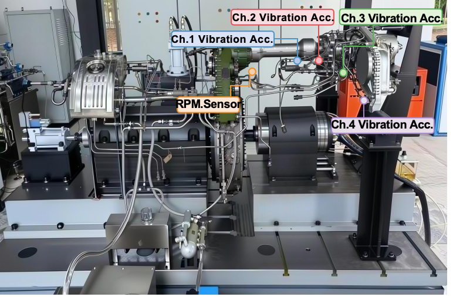

# PhyGate-Net

[](LICENSE)
[](https://www.python.org/)
[](https://pytorch.org/)
[](#citations)

Code for *Tracking predictable frequency drift improves bearing fault diagnosis
under cross-speed distribution shifts*.

Bearing fault signatures are not stationary in frequency: the characteristic fault
frequencies scale linearly with shaft speed, and across the operating range of the
aero-engine studied here they move by more than 65%. A model that learns fixed
spectral locations therefore degrades as soon as the machine changes speed.
PhyGate-Net anchors learnable spectral attention to bearing kinematics through a gate
that decides, per window, how far to trust the physical prior. It is evaluated by
training predominantly on higher-speed data and testing on held-out lower-speed data.

Developed at the [Intelligent Diagnosis and Expert Systems Laboratory
(IDES)](https://ides.nuaa.edu.cn/), Nanjing University of Aeronautics and Astronautics.

The release contains the data pipeline, the model and the training loop, and it
reproduces the forward and backward evaluation protocols described in the paper.

## Contents

- [Repository contents](#repository-contents)
- [Requirements](#requirements)
- [Data](#data)
- [Quick start](#quick-start)
- [Protocols](#protocols-and-what-this-release-covers)
- [Configuration](#configuration)
- [Code overview](#code-overview)
- [Outputs](#outputs)
- [Results reported in the paper](#results-reported-in-the-paper)
- [Citations](#citations)
- [License](#license)

## Repository contents

| File | Role |
|---|---|
| `codes/dataset_final_modified.py` | Reads the HDF5 recordings, cuts 2048-sample windows with stride 512, standardises each vibration channel within its recording, applies the 5000 rpm filter and builds the chronological forward / backward split. |
| `codes/model_final.py` | PhyGate-Net: multi-resolution time branch, physics-gated spectral attention branch, fusion and four-way classifier head. `create_model` is the entry point. |
| `codes/train_final.py` | Training and evaluation: warmup plus cosine schedule, early stopping, validation-based checkpointing, metrics and figures. |

`codes/train_final.py` imports `create_dataloaders` from the first file and `create_model`
from the second, so the three files must stay together in `codes/`.

The network class in the code is called `STLPhysicsNet` and is built through
`create_model(model_type='stl_physics')`; it is the model referred to as PhyGate-Net
in the paper.

## Requirements

```
python >= 3.9
torch
numpy
h5py
scikit-learn
matplotlib
seaborn
```

The reported experiments were run in the `torch_new` conda environment:

| Component | Version |
|---|---|
| Python | 3.11.15 |
| PyTorch | 2.6.0+cu124 (CUDA 12.4 build) |

Interpreter path on the training machine: `D:\Anaconda\envs\torch_new\python.exe`.

An older environment on the same machine was also used during development, with the
same code apart from the `torch.load` argument noted below:

| Component | Version |
|---|---|
| Python | 3.8.13 |
| PyTorch | 1.12.1+cu113 (CUDA 11.3 build) |

Interpreter path: `D:\Anaconda\envs\pytorch\python.exe`.

Training used the CUDA build on a GPU; the code also runs on CPU, and inference is
performed in single-precision floating point.

PyTorch 2.6 changed the default of `weights_only` in `torch.load` to `True`. The
checkpoints written by `codes/train_final.py` also carry the optimiser state and the training
history, so `Trainer.load_checkpoint` passes `weights_only=False` explicitly. That
argument was introduced in PyTorch 1.13; running the code under the 1.12 environment
above requires removing it again, or wrapping the call in a `try/except TypeError`.

## Data

### Test article

The data were acquired from a bearing mounted on a driven shaft inside the accessory
gearbox (AGB) of a real aero-engine assembly. The shaft is driven through a fixed 0.68
transmission ratio relative to the main shaft, so every speed reported here refers to
the driven shaft and already includes that factor.



*The test article. Four vibration channels (Ch.1–Ch.4) and one synchronously recorded
speed channel (RPM.Sensor) are mounted on the accessory gearbox of a real aero-engine
assembly; the instrumented bearing sits on a driven shaft inside the gearbox.*

Bearing geometry: 11 rolling elements, ball diameter 7.938 mm, pitch diameter 48.5 mm,
nominal contact angle 0°. Four states were recorded — healthy, inner-race fault,
outer-race fault and rolling-element fault — as seeded defects of controlled geometry.
There are no cage faults. Signals were sampled at 16 kHz, with four vibration channels
and one synchronously recorded speed channel at matching time resolution.

Across all valid windows the driven-shaft speed spans 5000–8259 rpm, with a mean of
6870 rpm and a standard deviation of 992 rpm.

### Class distribution

The four states are strongly imbalanced: inner race 35.9 %, outer race 29.8 %, rolling
element 29.2 %, healthy 5.2 %. Healthy windows are the minority class, which is why the
code reports healthy-class precision and recall alongside overall accuracy.

### Directory layout

`create_dataloaders` expects one folder per class directly under `data_root`:

```
data_root/
├── raw_data_combined_dynamic_无损伤_16kHz/     label 0   healthy
├── raw_data_combined_滚动体故障_hdf5_16kHz/     label 1   rolling element fault
├── raw_data_combined_内圈故障_hdf5_16kHz/       label 2   inner race fault
└── raw_data_combined_外圈故障_hdf5_16kHz/       label 3   outer race fault
```

The folder names are matched exactly and the class-to-label mapping is fixed in
`create_dataloaders`. Every `*.h5` file in a folder is one constant-condition
acquisition. Files are ordered by the number embedded in the file name
(`part1, part2, ... part10`), which keeps the record order — and with it the speed
ordering — identical across machines.

### File format

Each file is a pandas / PyTables table at `/data/table`, a compound dtype with three
fields:

| Field | dtype | Content |
|---|---|---|
| `index` | int64 | row number, not used |
| `values_block_0` | float64 × 6 | `Time_Sec`, `1Ha_Accel_ms2`, `2Ha_Accel_ms2`, `3Ha_Accel_ms2`, `4Ha_Accel_ms2`, `7Ha_Speed_RPM` |
| `values_block_1` | int64 × 1 | `Sample_Index`, not used |

The four vibration channels are `values_block_0[:, 1:5]` and the shaft speed in rpm is
`values_block_0[:, 5]`.

```python
import h5py

with h5py.File(path, "r") as f:
    d = f["data"]["table"][:]

vibration = d["values_block_0"][:, 1:5]   # (N, 4)
rpm       = d["values_block_0"][:, 5]     # (N,)

assert len(vibration) == len(rpm)         # synchronously sampled
```

`pandas.read_hdf(path, "data")` returns the same content as a DataFrame.

Recordings vary in length. Most files hold 6,560,000 samples (410 s at 16 kHz), but the
collection also contains shorter and longer acquisitions, from 112,000 samples (7 s) up
to 10,464,000 samples (654 s). `Time_Sec` is exactly `Sample_Index / 16000` within every
recording. The released signals are provided at 16 kHz in desensitised form; the usable
bandwidth is therefore 8 kHz.

The raw vibration channels carry a slowly drifting sensor offset (about 1.3e4, moving
from roughly 13,200 to 14,100 over the campaign) which is not physical acceleration.
The loader removes it by standardising each channel within its recording, as described
in Methods. If you read the raw files directly, subtract the per-recording mean first.

## Quick start

1. Set `DATA_ROOT` in `codes/train_final.py` to the folder that holds the four class
   subfolders.
2. Run:

```bash
cd codes
python train_final.py
```

The entry point at the bottom of the file selects the protocol:

```python
single_experiment(split_mode='temporal', temporal_direction='forward')
```

- `temporal_direction='forward'` — forward matched-condition reference: the first 85 %
  of each class is training, the next 10 % validation and the final 5 % test.
- `temporal_direction='backward'` — the primary cross-condition protocol: the first 5 %
  of each class becomes the test set, the next 10 % validation and the remaining 85 %
  training, so the model is trained mostly on higher speeds and tested on held-out
  lower speeds.

Both directions use the same windowing, model and optimiser.

## Protocols and what this release covers

| Protocol | Implemented here | Realised speed support |
|---|---|---|
| Forward matched-condition split | `temporal_direction='forward'` | 6824–7223 rpm |
| Backward cross-condition split (primary) | `temporal_direction='backward'` | 6951–5745 rpm |
| Overlap-reduced outer-race split | separate driver, not included | outer race: train ≥ 5920, test ≤ 6000 rpm |
| Five random seeds | separate driver, not included | — |

The overlap-reduced variant restricts outer-race training and validation windows to
≥ 5920 rpm and outer-race test windows to ≤ 6000 rpm while leaving the other classes on
the backward split. It is a filter applied on top of the split above, not a different
model or training loop.

## Configuration

| Setting | Value | Location |
|---|---|---|
| `DATA_ROOT` | path to the data folder | `codes/train_final.py` |
| Batch size | 128 | `codes/train_final.py` |
| Window / stride | 2048 / 512 samples (128 ms / 32 ms, 75 % overlap) | `codes/train_final.py` |
| Epochs | 50 | `codes/train_final.py` |
| Minimum window speed | 5000 rpm | `create_dataloaders` default |
| Optimizer | AdamW, lr 3e-4, weight decay 1e-4 | `Trainer.__init__` |
| Schedule | 3-epoch linear warmup, then cosine decay to 1e-6 | `Trainer.__init__`, `Trainer.train` |
| Early stopping | patience 3 on validation accuracy | `codes/train_final.py` |
| Decomposition kernels | 19 / 31 / 117 samples | `MultiScaleDecomp` default |
| Bearing geometry | 11 balls, ball Ø 7.938 mm, pitch Ø 48.5 mm, contact angle 0° | `BearingPhysicsCalculator` |

## Code overview

### Data pipeline — `codes/dataset_final_modified.py`

`BearingFaultDataset` runs two passes over the recordings.

The first pass, `_compute_global_rpm_stats`, reads only the speed column of every file
to obtain the global mean and standard deviation that the model uses to normalise the
speed channel. If `rpm_stats_cache.json` exists in `data_root` its `mean` and `std`
fields are used instead and the pass is skipped.

The second pass, `_load_all_files`, reads each recording through `_load_single_file`,
which

- takes `values_block_0[:, 1:5]` as vibration and `values_block_0[:, 5]` as rpm,
- standardises each vibration channel within the recording,
- keeps the speed channel unnormalised,
- cuts windows of 2048 samples with stride 512,
- drops windows whose mean speed is below `min_rpm`.

Each window is stored as `(2048, 5)` and returned transposed as `(5, 2048)`; the first
four rows are normalised vibration, the fifth is raw speed. Speed is not routed through
a separate encoding pathway — it enters the shared time-domain representation and its
trend–seasonal decomposition, while its within-window mean supplies the kinematic
quantities used by the frequency prior.

`create_dataloaders` groups window indices by class and splits each class
chronologically, so the three partitions never share a recording. For `'backward'` the
earliest windows become the test set and the latest become the training set; `'forward'`
reverses this. It returns the three `DataLoader` objects, the number of classes, and the
dataset object.

### Time branch — `codes/model_final.py`

```
Input (B, 5, 2048)
  │
  ├─ Conv1d projection 5 → 32
  ├─ moving-average decomposition, kernels 19 / 31 / 117
  │     ├─ Trend branch    large kernels 15 → 11 → 7             → 128
  │     ├─ Seasonal branch small kernels 7 → 5 + attention       → 128
  │     └─ Residual branch k=3, projected input − k=117 trend    → 64
  │
  └─ concat → 320-dimensional time-domain representation
```

The projection maps the five input channels to 32. Moving averages at three scales give
the trend components; subtracting each from the projected input gives the corresponding
seasonal components. Trend components are concatenated along channels and passed to the
large-kernel pathway, seasonal components to the small-kernel pathway followed by
multi-head self-attention, and the residual pathway receives the projected input minus
the trend at the largest scale, which preserves transient detail. The three outputs are
concatenated into 320 dimensions.

The three kernel sizes are fixed by the physics of the test article rather than by a
grid search. Each is the odd-rounded length that corresponds to one reference period
through `k_i = odd round(fs / f_i^ref)`:

| Scale | Reference frequency | Value | `fs / f` | Kernel | Duration |
|---|---|---|---|---|---|
| Shortest fault period | BPFI at `N_max` = 8259 rpm | 881.0 Hz | 18.16 | 19 | 1.19 ms |
| Fault period | BPFO at `N̄` = 6629.5 rpm | 508.2 Hz | 31.48 | 31 | 1.94 ms |
| Shaft modulation | `f_r` at `N_max` | 137.7 Hz | 116.24 | 117 | 7.31 ms |

The inputs to this calculation are the sampling rate, the speed range and the bearing
geometry, all fixed for the test article, so the three integers are computed once and do
not vary per window. They are set in `MultiScaleDecomp` and can be passed explicitly
through `STLPhysicsNet(decomp_kernel_sizes=...)`.

### Frequency branch — physics-gated spectral attention

`BearingPhysicsCalculator` computes the four characteristic frequencies from bearing
geometry and the within-window mean speed:

```
f_BPFO = (n/2) f_r (1 − (d/D) cos α)
f_BPFI = (n/2) f_r (1 + (d/D) cos α)
f_BSF  = (D/2d) f_r (1 − ((d/D) cos α)²)
f_FTF  = (f_r/2) (1 − (d/D) cos α)
```

with `n` rolling elements, ball diameter `d`, pitch diameter `D`, contact angle `α` and
shaft frequency `f_r` in Hz. Because these are evaluated per window from that window's
mean speed, the prior follows the operating condition of every individual window rather
than assuming a constant speed.

For each fault type `t` and harmonic `h ∈ {1,2,3}` a Gaussian kernel is placed at
`h · f_t`:

```
g_{t,h}(f) = exp(−(f − h f_t)² / (2 σ_t²))
```

and the physics mask is assembled on the FFT grid as

```
M_p(f) = (1/Z) Σ_t Σ_h w_t γ_h g_{t,h}(f) · 1[h f_t ∈ (0, f_Nyq)]
```

where `σ_t` is a learnable bandwidth per fault type, `w_t` a learnable fault-type
weight, `γ_h` a learnable harmonic attenuation initialised to (1.0, 0.8, 0.6), `Z` a
normalisation constant and `1[·]` discards harmonics beyond Nyquist.

The mask is gated by how well it matches the measured spectrum. The match score is the
normalised overlap between amplitude spectrum and mask,

```
s = Σ_f X(f) M_p(f) / (Σ_f X(f) + ε)
```

and the gate is a temperature-scaled sigmoid,

```
g = σ(T (s − σ(θ)))
```

with learnable `T` (initialised to 5) and threshold `θ`. The fused mask combines the
physics mask `M_p` with a learned mask `M_d` produced by an MLP:

```
M_f = α M_p + (1 − α) M_d,    α = σ(b) · g
```

where `b` is a learnable base coefficient and `α` the effective fusion weight. The gated
mask is applied to the amplitude spectrum; the weighted spectrum is log-compressed and
projected to the frequency-domain feature vector. Each of the four vibration channels
has its own attention module with its own `b`, so the gate can differ per sensor.

The gate starts near 0.083 after the first epoch and settles at α = 0.264 ± 0.027 at the
selected checkpoint, with class-mean differences below 0.006.

### Fusion and classifier

The 320-dimensional time-domain vector and the 128-dimensional frequency vector are
concatenated into 448 dimensions and passed through a small MLP to the four-way head
(healthy, rolling element, inner race, outer race). The optional speed-encoding pathway
that could inject the speed sequence directly is present but inactive in all reported
experiments, so the network contains no separate speed-encoding branch.

`create_model(model_type='stl_physics', ...)` builds the network and prints the parameter
count.

### Training — `codes/train_final.py`

`Trainer` holds the model, the three loaders, cross-entropy loss, AdamW and the schedule.
The schedule raises the learning rate linearly over three warmup epochs and then decays
it with `CosineAnnealingLR` to 1e-6. No explicit physics term appears in the loss: the
spectral prior enters only through the attention mechanism, which is what allows `α` to
be read as a quantity the model chooses rather than one the objective imposes.

Each epoch the validation accuracy is compared with the best so far and the checkpoint is
written whenever it improves; the test set is evaluated every epoch for monitoring only
and never decides which checkpoint is kept. Training stops after three consecutive epochs
without a validation improvement. When training finishes, `single_experiment` reloads
`best_model.pth` and runs `Trainer.test`, which prints the classification report and
writes the confusion matrix and ROC figures. Reported test metrics therefore always come
from the validation-selected checkpoint, which fell at epoch 7 in the main experiments.

Performance is reported as overall accuracy and macro-averaged F1 over the four classes,
together with precision and recall of the healthy class.

## Outputs

Each run writes to `codes/checkpoints/stl_physics_<split_mode>_<timestamp>/`:

| File | Content |
|---|---|
| `best_model.pth` | Best-validation checkpoint: weights, optimiser state, history, split mode |
| `training_history.json` | Per-epoch train, validation and test metrics |
| `confusion_matrix.png` | Confusion matrix on the test set |
| `roc_curves.png` | One-vs-rest ROC curves on the test set |
| `training_history.png` | Loss, accuracy, AUC and healthy-class recall curves |

The figure labels emitted by `plot_confusion_matrix`, `plot_roc_curves` and
`plot_training_history` are in Chinese; edit the label strings in those three methods for
English figures.

## Results reported in the paper

| Metric | Forward (matched) | Backward (cross-speed) |
|---|---|---|
| Accuracy | 99.91 ± 0.05 % | 92.81 ± 2.86 % |
| Macro-F1 | 99.92 ± 0.04 % | 93.40 ± 2.78 % |
| Healthy precision | 1.000 ± 0.000 | 1.000 ± 0.000 |
| Healthy recall | 1.000 ± 0.000 | 0.987 ± 0.026 |
| Δ accuracy | — | −7.10 pp |

Mean ± SD over five random seeds, validation-selected checkpoints at epoch 7. Most
baseline architectures lose roughly 20–40 percentage points under the same backward
protocol. In the best-performing individual run the model reaches 97.4 % accuracy with
100 % healthy-class precision and recall; the outer-race class reaches 90.6 % recall,
with 8.8 % of its errors assigned to ball faults and 0.5 % to inner-race faults.

Component ablations, all under the backward protocol: removing the frequency branch
reduces accuracy to 59.6 %, while removing the physics mask or the seasonal attention
reduces healthy-class recall to 6.0 % and 0.0 % respectively.

Under the overlap-reduced outer-race split the validation-selected model (epoch 5)
retains 93.79 % test accuracy with 100 % healthy-class recall. Training and test
outer-race windows then share only the 5920.00–5998.61 rpm band, 2.37 % of outer-race
test windows, with no common source files and no overlapping raw windows; excluding those
windows leaves the remaining test accuracy at ≥ 93.76 %.

## Citations

> Zhou, S., Liang, S., Chen, G., Sheng, J. & Wei, X. Tracking predictable frequency
> drift improves bearing fault diagnosis under cross-speed distribution shifts.
> *Nature Communications*, under review.

If you use this dataset in a publication, please cite both the associated paper above
and the dataset record itself, including its DOI and version.

## License

© 2026 Siyi Zhou, Shi Liang, Guo Chen, Jiajiu Sheng and Xunkai Wei.

Code and data are released under the Creative Commons Attribution 4.0 International
licence (CC BY 4.0), https://creativecommons.org/licenses/by/4.0/.

You are free to share and adapt the material for any purpose, including commercially,
provided that you give appropriate credit, provide a link to the licence, and indicate
whether changes were made.
